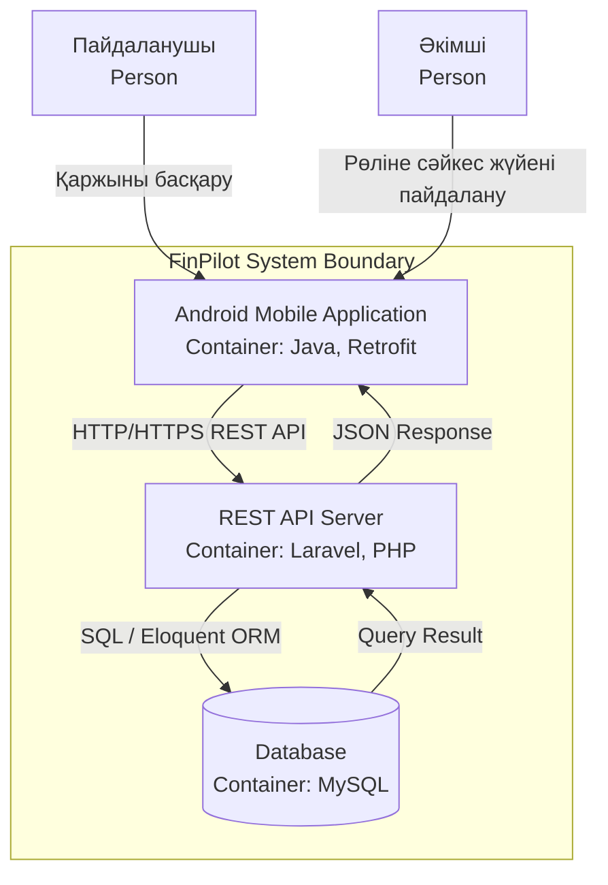
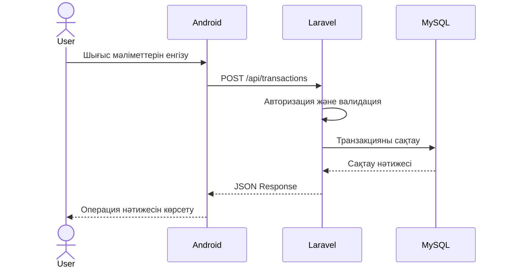
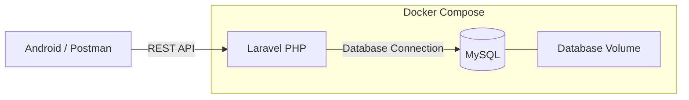
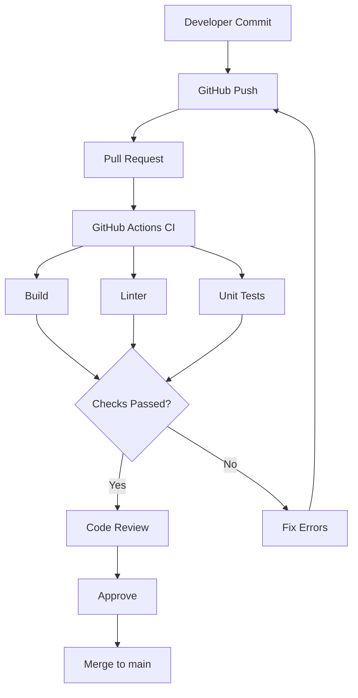

# FinPilot — Жүйе архитектурасы

## 1. Жалпы сипаттама

FinPilot — пайдаланушылардың жеке қаржысын басқаруға арналған мобильді қосымша.

Жүйе кірістер мен шығыстарды тіркеуге, айлық бюджетті жоспарлауға, қаржылық операциялар тарихын сақтауға және статистиканы бақылауға мүмкіндік береді.

Жоба клиент-серверлік архитектура негізінде әзірленеді.

## 2. Қолданылатын технологиялар

| Технология | Қолданылуы |
|---|---|
| Android Studio | Мобильді қосымшаны әзірлеу |
| Java | Мобильді қосымшаның бағдарламалау тілі |
| Retrofit | REST API-мен байланыс |
| PHP | Серверлік бағдарламалау |
| Laravel | REST API және бизнес-логика |
| MySQL | Деректерді сақтау |
| Docker Compose | Серверлік ортаны іске қосу |
| GitHub Actions | Үздіксіз интеграция (CI) |
| Swagger | REST API құжаттамасы |
| Postman | API тестілеу |

## 3. Архитектуралық қабаттар

### 3.1. Presentation Layer — Интерфейс қабаты

Android Studio және Java арқылы жүзеге асырылады.

Міндеттері:

- Пайдаланушыны тіркеу және жүйеге кіру;
- Кірістер мен шығыстарды енгізу;
- Қаржылық операциялар тарихын көрсету;
- Айлық бюджетті басқару;
- Қаржылық статистиканы көрсету;
- Пайдаланушы профилін басқару.

### 3.2. API Layer — Байланыс қабаты

Android қосымшасы мен Laravel серверінің арасындағы байланысты қамтамасыз етеді.

Міндеттері:

- Retrofit арқылы HTTP сұраныстарын жіберу;
- REST API сұраныстарын қабылдау;
- JSON форматындағы мәліметтерді өңдеу;
- Авторизация токендерін жіберу;
- Сервер жауаптарын мобильді қосымшаға жеткізу.

### 3.3. Business Logic Layer — Бизнес-логика қабаты

Laravel және PHP арқылы жүзеге асырылады.

Міндеттері:

- Пайдаланушыларды тіркеу және авторизациялау;
- Пайдаланушы рөлдерін басқару;
- Қаржылық операцияларды өңдеу;
- Кірістер мен шығыстарды есептеу;
- Айлық бюджетті басқару;
- Қаржылық статистиканы есептеу;
- Енгізілген мәліметтерді тексеру.

### 3.4. Data Access Layer — Деректерге қол жеткізу қабаты

Repository Pattern және Laravel Eloquent ORM арқылы жүзеге асырылады.

Міндеттері:

- Дерекқорға сұраныс жіберу;
- Мәліметтерді қосу;
- Мәліметтерді оқу;
- Мәліметтерді өзгерту;
- Мәліметтерді жою;
- Бизнес-логиканы дерекқормен жұмыс істеу кодынан бөлу.

### 3.5. Database Layer — Дерекқор қабаты

MySQL дерекқоры арқылы жүзеге асырылады.

Міндеттері:

- Пайдаланушылар туралы ақпаратты сақтау;
- Пайдаланушы рөлдерін сақтау;
- Кірістер мен шығыстарды сақтау;
- Қаржылық санаттарды сақтау;
- Айлық бюджеттерді сақтау;
- Деректердің тұтастығын қамтамасыз ету.

## 4. C4 Container диаграммасы

C4 Container диаграммасы FinPilot жүйесінің негізгі бағдарламалық компоненттерін және олардың арасындағы байланысты көрсетеді.



### Диаграмма компоненттері

| Компонент | Қызметі |
|---|---|
| User | Жеке қаржысын басқарады |
| Admin | Рөліне сәйкес рұқсат етілген әрекеттерді орындайды |
| Android Application | Пайдаланушы интерфейсін қамтамасыз етеді |
| Laravel REST API | Сұраныстарды және бизнес-логиканы өңдейді |
| MySQL Database | Жүйе мәліметтерін сақтайды |

## 5. Серверлік архитектура

Laravel серверінің жоспарланған құрылымы:

```text
backend/
├── app/
│   ├── Http/
│   │   ├── Controllers/
│   │   ├── Middleware/
│   │   └── Requests/
│   ├── Models/
│   ├── Services/
│   └── Repositories/
├── routes/
│   └── api.php
├── database/
│   ├── migrations/
│   └── seeders/
├── tests/
│   ├── Unit/
│   └── Feature/
├── Dockerfile
└── composer.json
```

| Компонент | Міндеті |
|---|---|
| Controllers | API сұраныстарын қабылдау |
| Middleware | Авторизация және рұқсаттарды тексеру |
| Requests | Мәліметтерді валидациялау |
| Models | Дерекқор модельдері |
| Services | Бизнес-логиканы орындау |
| Repositories | Дерекқормен жұмыс істеу |
| Routes | API маршруттарын анықтау |
| Migrations | Дерекқор құрылымын басқару |
| Seeders | Бастапқы тестілік мәліметтерді енгізу |
| Tests | Автоматтандырылған тестілеу |

## 6. Мобильді қосымшаның архитектурасы

Android қосымшасының жоспарланған құрылымы:

```text
android/
└── app/
    └── src/main/
        ├── java/
        │   ├── activities/
        │   ├── adapters/
        │   ├── models/
        │   ├── network/
        │   ├── repositories/
        │   └── viewmodels/
        └── res/
            ├── layout/
            ├── drawable/
            └── values/
```

Android қосымшасы Retrofit арқылы Laravel REST API серверімен байланысады.

## 7. REST API жоспары

| HTTP Method | Endpoint | Қызметі |
|---|---|---|
| POST | /api/register | Тіркелу |
| POST | /api/login | Жүйеге кіру |
| POST | /api/logout | Жүйеден шығу |
| GET | /api/transactions | Операциялар тізімі |
| POST | /api/transactions | Операция қосу |
| GET | /api/transactions/{id} | Операцияны көру |
| PUT | /api/transactions/{id} | Операцияны өзгерту |
| DELETE | /api/transactions/{id} | Операцияны жою |
| GET | /api/categories | Санаттарды көру |
| POST | /api/categories | Санат қосу |
| GET | /api/budgets | Айлық бюджеттерді көру |
| POST | /api/budgets | Айлық бюджет орнату |
| PUT | /api/budgets/{id} | Айлық бюджетті өзгерту |
| GET | /api/statistics | Қаржылық статистика |

API Swagger арқылы құжатталады және Postman арқылы тексеріледі.

## 8. Жүйенің жұмыс істеу процесі

Мысал: пайдаланушы жаңа шығыс қосады.



## 9. Дерекқор архитектурасы

Дерекқор MySQL негізінде құрылады.

Дерекқордың ER диаграммасы:

[ER_DIAGRAM.md](ER_DIAGRAM.md)

Бастапқы мәліметтер жоспары:

[SEED_PLAN.md](SEED_PLAN.md)

Негізгі талаптар:

- Primary Key және Foreign Key қолдану;
- 1:N және M:N байланыстарын ұйымдастыру;
- Пайдаланушы мәліметтерін оқшаулау;
- Құпиясөздерді хэштеу;
- Бір пайдаланушының бір айға арналған негізгі бюджетінің қайталанбауы;
- Деректердің тұтастығын қамтамасыз ету.

README және ER диаграммасындағы кестелер құрылымы backend әзірлеу алдында сәйкестендіріледі.

## 10. Design Patterns

FinPilot жобасында келесі жобалау үлгілерін қолдану жоспарланған:

| Pattern | Тобы | Қолданылуы |
|---|---|---|
| Repository | Architectural | Деректермен жұмыс істеу логикасын бөлу |
| Adapter | Structural | API деректерін мобильді модельдерге бейімдеу |
| Strategy | Behavioral | Қаржылық статистиканы есептеу |
| Builder | Creational | Қаржылық есептерді құрастыру |
| Memento | Behavioral | Бюджеттің алдыңғы күйін сақтау |
| Observer | Behavioral | Деректер өзгергенде интерфейсті жаңарту |

Толық паттерндер жоспары PATTERNS.md құжатында сипатталады.

## 11. Docker архитектурасы

Серверлік ортаны Docker Compose арқылы іске қосу жоспарланған.



Docker Compose құрамында:

- Laravel серверлік контейнері;
- MySQL дерекқор контейнері;
- Дерекқор мәліметтеріне арналған Volume;
- Контейнерлер арасындағы Network.

Іске қосу командасы:

```bash
docker compose up --build
```

Android қосымшасы Android Studio эмуляторында немесе мобильді құрылғыда іске қосылады.

## 12. GitHub Actions CI

CI — кодты үздіксіз интеграциялау және автоматты тексеру процесі.



CI міндеттері:

- Backend және Android кодтарын автоматты тексеру;
- Build процесін орындау;
- Linter арқылы код сапасын тексеру;
- Unit Test нәтижелерін тексеру;
- Қателерді анықтау;
- Код интеграциясын бақылау.

CI конфигурациясының жоспарланған орналасуы:

```text
.github/workflows/ci.yml
```

## 13. Қауіпсіздік

Жобада келесі қауіпсіздік механизмдері қарастырылады:

- Authentication;
- Authorization;
- Role-Based Access Control;
- Password Hashing;
- Input Validation;
- Token-based Authentication;
- Пайдаланушы деректерін оқшаулау;
- Құпия параметрлерді environment variables арқылы басқару.

## 14. Команда мүшелерінің жауапкершілігі

| Команда мүшесі | Рөлі | Жауапкершілігі |
|---|---|---|
| Аружан | Team Lead / Architect | Архитектура, C4, паттерндер, Code Review |
| Еркін | Backend Developer | Laravel, PHP, MySQL, REST API |
| Жәнібек | Mobile Developer | Android, Java, Retrofit, UI |
| Досжан | QA & DevOps Engineer | Docker, CI, тестілеу, код интеграциясы |

## 15. Қорытынды
##16.Design Review №1 — іске асырылған архитектура
##16.1Backend
FinPilot жүйесінің серверлік бөлігі PHP тілінде Laravel фреймворкі арқылы жүзеге асырылды. Мобильді қосымшамен байланысу үшін 10 REST API маршруты құрылды.
##16.2 Авторизация және қауіпсіздік
Laravel Sanctum арқылы токендік авторизация жүзеге асырылды. Жүйеде екі рөл бар:
User — өзінің қаржылық транзакцияларын басқарады.
Admin — пайдаланушылар тізімін көре алады.
Қарапайым пайдаланушы Admin бөліміне кірген кезде сервер 403 Forbidden жауабын қайтарады.
##16.3Дерекқор
MySQL дерекқорында users, roles, categories, transactions және personal_access_tokens кестелері құрылды. Кестелер Laravel миграциялары арқылы басқарылады.
##16.4 Repository Pattern
TransactionRepository класы дерекқормен жұмыс істеу логикасын контроллерден бөледі. Қаржылық транзакцияларды қосу, оқу, өзгерту және жою операциялары жүзеге асырылды.
##16.5 Инфрақұрылым
Docker Compose арқылы Laravel және MySQL контейнерлері іске қосылады. Swagger UI арқылы REST API функциялары тексерілді.
GitHub Actions арқылы кодтың жазылу стандарты және автоматтандырылған тесттер тексеріледі.
##16.6 Мобильді қосымшамен интеграция
Келесі кезеңде Android Studio ортасында Java тілінде мобильді қосымша әзірленіп, Retrofit арқылы Laravel REST API жүйесіне қосылады.
