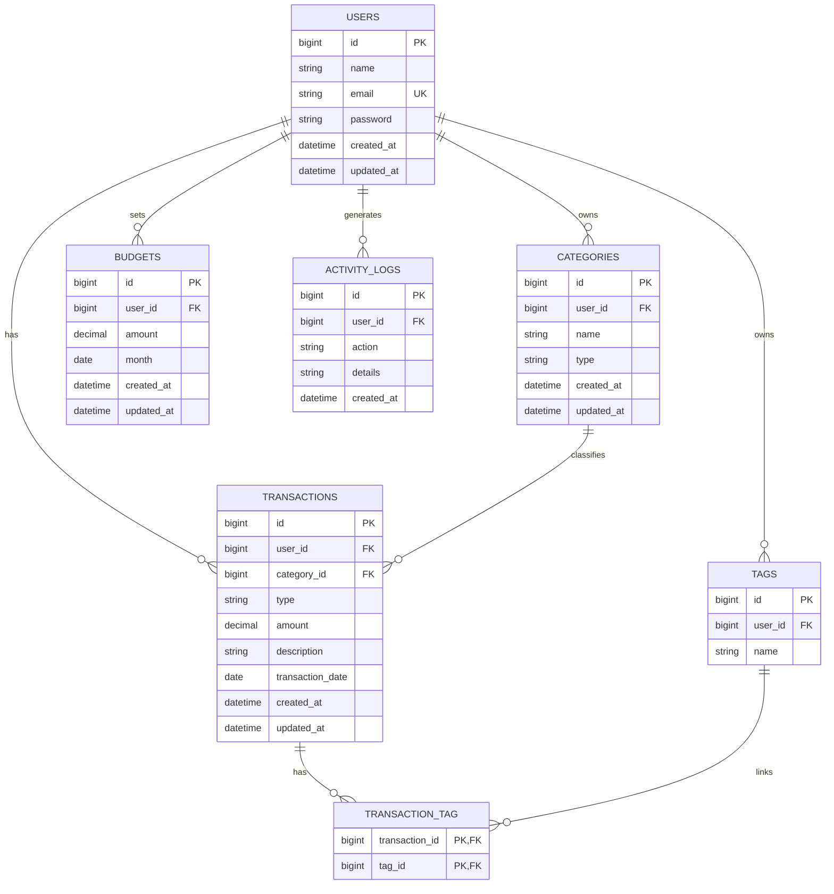

# FinPilot — ER диаграммасы

## 1. Дерекқордың мақсаты

FinPilot жүйесінің дерекқоры пайдаланушылардың кірістерін,
шығыстарын, бюджеттерін, қаржылық санаттарын және жүйедегі
әрекеттерін сақтауға арналған.

Дерекқорды басқару жүйесі: MySQL.
Backend: Laravel (PHP).

## 2. ER диаграммасы

## 3. Дерекқор субъектілері

| Кесте | Қызметі |
|---|---|
| users | Пайдаланушылардың аккаунттарын сақтау |
| categories | Кіріс пен шығыс санаттарын сақтау |
| transactions | Қаржылық операцияларды сақтау |
| budgets | Айлық бюджет шектеулерін сақтау |
| tags | Транзакция белгілерін сақтау |
| transaction_tag | Транзакциялар мен белгілерді байланыстыру |
| activity_logs | Жүйедегі әрекеттер тарихын сақтау |

## 4. Байланыстар

### 1:N — One-to-Many

Бірден көпке байланысы:

- Бір пайдаланушыда бірнеше транзакция болады.
- Бір пайдаланушыда бірнеше санат болады.
- Бір пайдаланушыда бірнеше айлық бюджет болады.
- Бір пайдаланушыда бірнеше белгі болады.
- Бір пайдаланушыда бірнеше әрекет жазбасы болады.
- Бір санатқа бірнеше транзакция тиесілі болады.

### M:N — Many-to-Many

Көптен көпке байланысы:

- Бір транзакцияда бірнеше белгі болуы мүмкін.
- Бір белгі бірнеше транзакцияға тиесілі болуы мүмкін.
- Байланыс transaction_tag аралық кестесі арқылы жүзеге асырылады.

Мысалы, тамаққа жұмсалған шығынға "Күнделікті"
және "Отбасы" белгілерін қосуға болады.

## 5. Дерекқор кілттері

- PK (Primary Key) — кестедегі бірегей идентификатор.
- FK (Foreign Key) — басқа кестемен байланыс орнататын кілт.
- UK (Unique Key) — қайталанбайтын мән.

## 6. Деректердің тұтастығы және қауіпсіздігі

- Пайдаланушының email мекенжайы қайталанбауы керек.
- Құпиясөздер хэштелген түрде сақталуы керек.
- Транзакция сомасы нөлден үлкен болуы керек.
- Пайдаланушы тек өзінің қаржылық деректеріне қол жеткізеді.
- Транзакцияның санаты сол пайдаланушыға тиесілі болуы керек.
- Транзакция мен оған қосылатын белгі бір пайдаланушыға тиесілі болуы керек.
- Бір пайдаланушыға бір айда бір бюджет жазбасы беріледі.
- Аралық кестеде бірдей байланыс қайталанбауы керек.
- Сыртқы кілттер арқылы деректердің тұтастығы қамтамасыз етіледі.

## 7. User Story және дерекқор байланысы

| User Story | Қолданылатын кестелер |
|---|---|
| US-01 — Тіркелу | users |
| US-02 — Авторизация | users |
| US-03 — Кіріс қосу | transactions, categories |
| US-04 — Шығыс қосу | transactions, categories |
| US-05 — Өзгерту және жою | transactions |
| US-06 — Санаттарды басқару | categories |
| US-07 — Бюджет орнату | budgets |
| US-08 — Бюджет ескертуі | budgets, transactions |
| US-09 — Статистика | transactions |
| US-10 — Іздеу және сүзгілеу | transactions, categories, tags, transaction_tag |
| US-11 — Есепті экспорттау | transactions, categories |
| US-12 — Журналдау | activity_logs |

## 8. Қорытынды

FinPilot жобасының дерекқор құрылымы 7 кестеден тұрады.
ER диаграммасында 1:N және M:N байланыстары көрсетілген.

Бұл құрылым Laravel REST API және Android мобильді
қосымшасын әзірлеуге негіз болады.

Жауапты: Backend Developer — Еркін.

GitHub Issue: #6.
