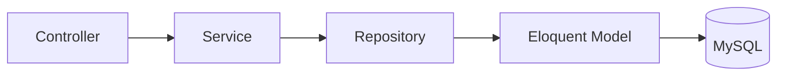
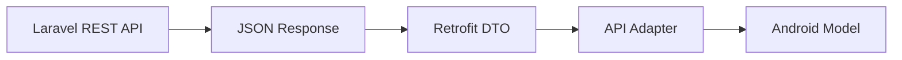
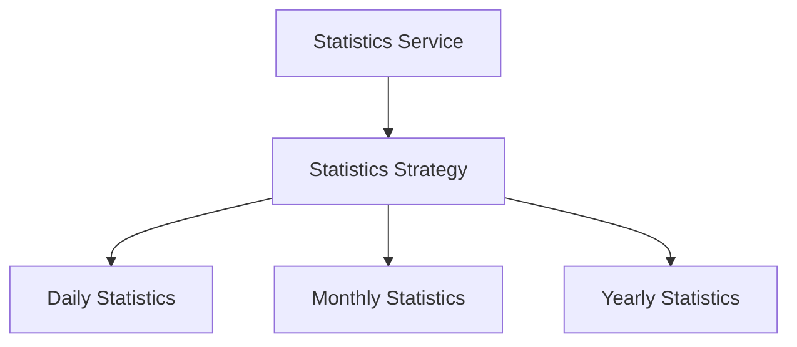
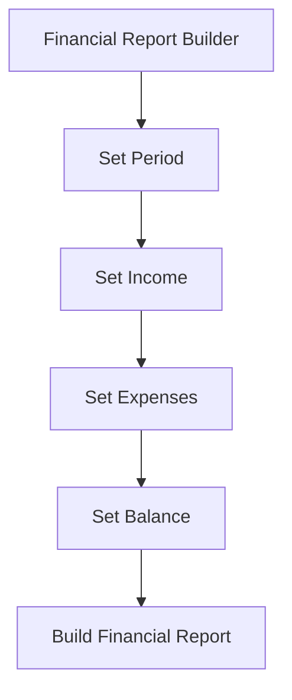
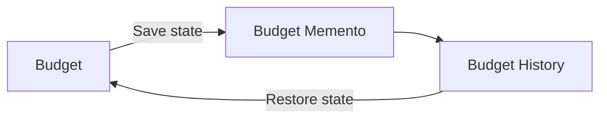
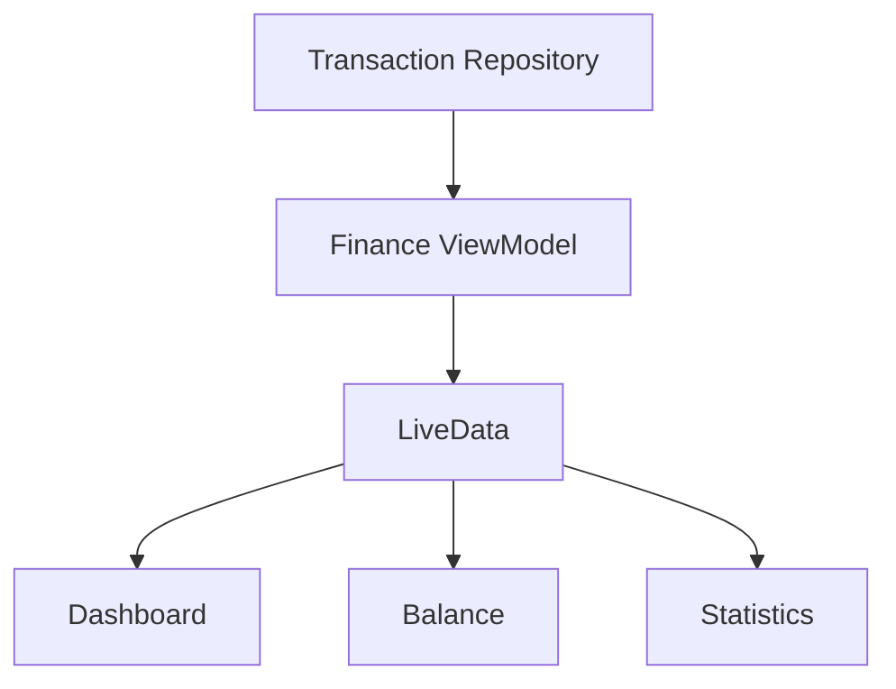

# FinPilot — Design Patterns

## 1. Жалпы сипаттама

FinPilot жобасында бағдарламалық архитектураны жақсарту,
кодты қайта пайдалануды жеңілдету, жүйені кеңейту және
компоненттер арасындағы тәуелділікті азайту мақсатында
алты жобалау үлгісін қолдану жоспарланған.

## 2. Паттерндердің жіктелуі

| № | Pattern | Тобы | Модуль |
|---|---|---|---|
| 1 | Repository | Architectural | Data Access |
| 2 | Adapter | Structural | API Integration |
| 3 | Strategy | Behavioral | Statistics |
| 4 | Builder | Creational | Reports |
| 5 | Memento | Behavioral | Budget |
| 6 | Observer | Behavioral | Android UI |

Жобада үш негізгі топ қамтылады:

- Creational — Builder;
- Structural — Adapter;
- Behavioral — Strategy, Memento, Observer.

Repository қосымша архитектуралық паттерн ретінде қолданылады.

## 3. Repository Pattern

### Тобы

Architectural Pattern.

### Қолданылатын модуль

Laravel Backend — Data Access Layer.

### Шешетін мәселесі

Дерекқормен жұмыс істеу коды бизнес-логикамен араласып
кеткен жағдайда жүйені өзгерту және тестілеу қиындайды.

### Шешімі

Дерекқормен жұмыс істеу операцияларын жеке Repository
қабатына орналастыру.

### Жүзеге асыру жоспары

- TransactionRepositoryInterface;
- TransactionRepository;
- BudgetRepository;
- TransactionService.

### Жұмыс істеу схемасы

### FinPilot жобасындағы мысал

Пайдаланушы жаңа шығыс қосқанда TransactionService
мәліметтерді TransactionRepository арқылы MySQL
дерекқорына сақтайды.

### Артықшылықтары

- Бизнес-логика дерекқор кодынан бөлінеді;
- Кодты тестілеу жеңілдейді;
- Дерекқормен жұмыс бір жерде ұйымдастырылады.

Жауапты: Еркін — Backend Developer.

## 4. Adapter Pattern

### Тобы

Structural Pattern.

### Қолданылатын модуль

Android — REST API Integration.

### Шешетін мәселесі

Laravel серверінен JSON форматында алынған мәліметтердің
құрылымы Android қосымшасының ішкі модельдерінен
ерекшеленуі мүмкін.

### Шешімі

API мәліметтерін Android қосымшасына қажетті форматқа
түрлендіретін Adapter класын қолдану.

### Жүзеге асыру жоспары

- TransactionResponse;
- TransactionApiAdapter;
- TransactionModel.

### Жұмыс істеу схемасы

### FinPilot жобасындағы мысал

Серверден алынған транзакция мәліметтері Android
қосымшасының TransactionModel объектісіне түрлендіріледі.

### Артықшылықтары

- Әртүрлі деректер форматтарын байланыстырады;
- Android интерфейсін API құрылымынан тәуелсіз етеді;
- Кодты қайта пайдалануға мүмкіндік береді.

Жауапты: Жәнібек — Mobile Developer.

## 5. Strategy Pattern

### Тобы

Behavioral Pattern.

### Қолданылатын модуль

Қаржылық статистика.

### Шешетін мәселесі

Күнделікті, айлық және жылдық статистиканы бір әдістің
ішінде көптеген шарттар арқылы есептеу кодты күрделендіреді.

### Шешімі

Әр есептеу алгоритмін жеке Strategy класында жүзеге асыру.

### Жүзеге асыру жоспары

- StatisticsStrategy;
- DailyStatistics;
- MonthlyStatistics;
- YearlyStatistics;
- StatisticsService.

### Жұмыс істеу схемасы

### FinPilot жобасындағы мысал

Пайдаланушы айлық статистиканы таңдағанда MonthlyStatistics
алгоритмі таңдалған айдың кірістерін, шығыстарын және
балансын есептейді.

### Артықшылықтары

- Есептеу алгоритмдерін оңай ауыстыру;
- Жаңа статистика түрлерін қосу;
- Кодтың күрделілігін азайту.

Жауапты: Еркін — Backend Developer.

## 6. Builder Pattern

### Тобы

Creational Pattern.

### Қолданылатын модуль

Қаржылық есептерді қалыптастыру.

### Шешетін мәселесі

Қаржылық есеп бірнеше параметрден тұрады. Барлық
параметрлерді бір конструктор арқылы беру кодты
күрделендіреді.

### Шешімі

Қаржылық есеп объектісін бірнеше кезең арқылы құрастыру.

### Жүзеге асыру жоспары

- FinancialReport;
- FinancialReportBuilder;
- ReportService.

### Жұмыс істеу схемасы

### FinPilot жобасындағы мысал

Қаржылық есепті құрастыру кезінде келесі мәліметтер
кезең-кезеңімен енгізіледі:

- Есеп беру кезеңі;
- Жалпы кіріс;
- Жалпы шығыс;
- Қалған баланс;
- Қажет болған жағдайда санаттар.

### Артықшылықтары

- Күрделі объектілерді ыңғайлы құрастыру;
- Кодтың оқылуын жақсарту;
- Есеп параметрлерін икемді басқару.

Жауапты: Еркін — Backend Developer.

## 7. Memento Pattern

### Тобы

Behavioral Pattern.

### Қолданылатын модуль

Айлық бюджетті басқару.

### Шешетін мәселесі

Пайдаланушы бюджет сомасын өзгерткен кезде алдыңғы
мәнін жоғалтып алуы мүмкін.

### Шешімі

Бюджеттің алдыңғы күйін арнайы Memento объектісінде
сақтау және қажет болған жағдайда қалпына келтіру.

### Жүзеге асыру жоспары

- Budget;
- BudgetMemento;
- BudgetHistory.

### Жұмыс істеу схемасы

### FinPilot жобасындағы мысал

Пайдаланушының бастапқы айлық бюджеті 150000 теңге.

Пайдаланушы бюджетті 200000 теңгеге өзгертеді.

Алдыңғы 150000 теңгелік бюджет Memento объектісінде
сақталады. Қажет болған жағдайда алдыңғы мән
қалпына келтіріледі.

### Артықшылықтары

- Алдыңғы күйді сақтау;
- Өзгерістерді кері қайтару;
- Бюджет параметрлерін қалпына келтіру.

Жауапты: Еркін — Backend Developer.

## 8. Observer Pattern

### Тобы

Behavioral Pattern.

### Қолданылатын модуль

Android пайдаланушы интерфейсі.

### Шешетін мәселесі

Қаржылық мәліметтер өзгерген кезде интерфейстегі
ақпаратты қолмен жаңарту қажет болуы мүмкін.

### Шешімі

Деректердің өзгеруін бақылайтын Observer механизмін
қолдану.

Android ортасында LiveData арқылы жүзеге асыру
жоспарланған.

### Жүзеге асыру жоспары

- TransactionRepository;
- FinanceViewModel;
- LiveData;
- DashboardActivity.

### Жұмыс істеу схемасы

### FinPilot жобасындағы мысал

Пайдаланушы 5000 теңге шығыс қосқанда серверден
жаңартылған мәліметтер алынады.

ViewModel ішіндегі LiveData жаңартылады және оны
бақылайтын Android интерфейсі жаңа баланс пен
статистиканы автоматты түрде көрсетеді.

Бұл механизм Push Notification жіберуге арналмаған.

### Артықшылықтары

- Интерфейстің автоматты жаңаруы;
- Компоненттер арасындағы тәуелділіктің азаюы;
- Қаржылық ақпараттың өзекті болуы.

Жауапты: Жәнібек — Mobile Developer.

## 9. Паттерндерді жүзеге асыру жоспары

| Pattern | Модуль | Жауапты | Күйі |
|---|---|---|---|
| Repository | Backend / Database | Еркін | Planned |
| Adapter | Android / API | Жәнібек | Planned |
| Strategy | Statistics | Еркін | Planned |
| Builder | Reports | Еркін | Planned |
| Memento | Budget | Еркін | Planned |
| Observer | Android UI | Жәнібек | Planned |

Алғашқы кезеңде Transactions CRUD модулінде
Repository Pattern жүзеге асыру ұсынылады.

Қалған паттерндер тиісті модульдерді әзірлеу
барысында кезең-кезеңімен енгізіледі.

## 10. Паттерндерді тестілеу жоспары

| Pattern | Тексерілетін әрекет |
|---|---|
| Repository | Транзакцияны қосу, оқу, өзгерту және жою |
| Adapter | API мәліметтерін Android моделіне түрлендіру |
| Strategy | Күндік, айлық және жылдық есептеу нәтижелері |
| Builder | Қаржылық есептің дұрыс қалыптасуы |
| Memento | Бюджеттің алдыңғы күйін қалпына келтіру |
| Observer | Деректер өзгергенде интерфейстің жаңаруы |

Тестілеу түрлері:

- Unit Testing;
- Integration Testing;
- API Testing;
- UI Testing;
- GitHub Actions CI.

Жауапты: Досжан — QA & DevOps Engineer.

Архитектуралық сәйкестікті тексеру және Code Review:

Аружан — Team Lead / Architect.

## 11. Қорытынды

FinPilot жобасында алты жобалау үлгісін қолдану
жоспарланған.

Олардың бесеуі Creational, Structural және Behavioral
топтарына жатады. Repository қосымша архитектуралық
паттерн ретінде қарастырылады.

Таңдалған паттерндер жүйенің архитектурасын жақсартуға,
код сапасын арттыруға, тестілеуді жеңілдетуге және
болашақта жаңа функциялар қосуға мүмкіндік береді.

Бұл құжат паттерндерді жүзеге асыру жоспарын сипаттайды.
Паттерндердің нақты орындалуы бағдарламалық код пен
тестілеу нәтижелері арқылы расталады.
