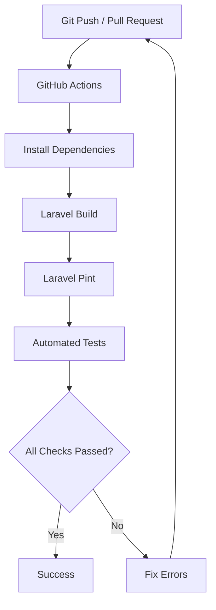

# FinPilot — Тестілеу жоспары (Test Plan)

## 1. Жалпы ақпарат

- Жоба атауы: FinPilot — Personal Finance Management System
- Команда: Team 2
- Жауапты маман: Қасымжанов Досжан
- Рөлі: QA & DevOps Engineer
- Құжат нұсқасы: 1.0
- Күні: 26.11.2026

## 2. Тестілеудің мақсаты

FinPilot жүйесінің функционалдық талаптарға сәйкестігін, 
тұрақтылығын, қауіпсіздігін және дұрыс жұмыс істеуін тексеру.

Тестілеудің негізгі мақсаттары:

- Бағдарламалық қателерді анықтау.
- Бизнес-логиканың дұрыс орындалуын тексеру.
- REST API жұмысын тексеру.
- Дерекқордың дұрыс жұмыс істеуін тексеру.
- Пайдаланушы деректерінің қауіпсіздігін қамтамасыз ету.
- Android және Laravel арасындағы байланысты тексеру.

## 3. Тестілеу құралдары

| Құрал | Қолданылуы |
|---|---|
| PHPUnit | Автоматтандырылған тесттер |
| Laravel Testing | Backend және API тестілеу |
| Postman | REST API сұраныстарын тексеру |
| Swagger | API құжаттамасы және тексеру |
| Laravel Pint | PHP код сапасын тексеру |
| GitHub Actions | Автоматтандырылған CI |
| Docker Compose | Тестілеу ортасын іске қосу |
| MySQL | Дерекқормен байланысты тексеру |
| Android Studio | Мобильді қосымшаны тестілеу |

## 4. Тестілеу түрлері

### 4.1. Unit Testing

Жүйенің жеке функциялары мен бизнес-логикасын 
басқа компоненттерден тәуелсіз тексеру.

### 4.2. Integration Testing

Laravel, MySQL және Android компоненттерінің 
өзара дұрыс байланысуын тексеру.

### 4.3. API Testing

REST API сұраныстарын, жауаптарын және HTTP 
статус кодтарын тексеру.

### 4.4. UI Testing

Мобильді қосымшаның интерфейсін, батырмаларын, 
енгізу өрістерін және навигациясын тексеру.

### 4.5. Security Testing

Авторизацияны, пайдаланушы рөлдерін, деректерге 
қолжетімділікті және құпиясөз қауіпсіздігін тексеру.

## 5. Unit Test сценарийлері

| ID | Тестілеу сценарийі | Күтілетін нәтиже |
|---|---|---|
| UT-01 | Кіріс сомасын есептеу | Жалпы кіріс дұрыс есептеледі |
| UT-02 | Шығыс сомасын есептеу | Жалпы шығыс дұрыс есептеледі |
| UT-03 | Балансты есептеу | Кіріс пен шығыс айырмасы анықталады |
| UT-04 | Теріс соманы тексеру | Теріс сома қабылданбайды |
| UT-05 | Нөлдік соманы тексеру | Нөлдік сома қабылданбайды |
| UT-06 | Айлық бюджетті тексеру | Бюджет сомасы нөлден үлкен болуы тиіс |
| UT-07 | Қалған бюджетті есептеу | Бюджет пен шығыс айырмасы есептеледі |
| UT-08 | Күндік статистиканы есептеу | Күндік нәтиже дұрыс есептеледі |
| UT-09 | Айлық статистиканы есептеу | Айлық нәтиже дұрыс есептеледі |
| UT-10 | Жылдық статистиканы есептеу | Жылдық нәтиже дұрыс есептеледі |

Барлық Unit Test сценарийлері тиісті бизнес-логика 
дайын болғаннан кейін PHPUnit арқылы жүзеге асырылады.

## 6. Функционалдық және API тестілеу

| ID | Сценарий | Күтілетін нәтиже | Күйі |
|---|---|---|---|
| FT-01 | Жаңа пайдаланушыны тіркеу | Аккаунт жасалады | Planned |
| FT-02 | Дұрыс құпиясөзбен кіру | Жүйеге кіреді | Planned |
| FT-03 | Қате құпиясөзбен кіру | Қолжетімділік берілмейді | Planned |
| FT-04 | Қайталанатын email енгізу | Тіркелуге рұқсат берілмейді | Planned |
| FT-05 | Кіріс қосу | Дерекқорға сақталады | Planned |
| FT-06 | Шығыс қосу | Дерекқорға сақталады | Planned |
| FT-07 | Транзакциялар тізімін алу | Мәліметтер көрсетіледі | Planned |
| FT-08 | Транзакцияны өзгерту | Мәлімет жаңартылады | Planned |
| FT-09 | Транзакцияны жою | Мәлімет жойылады | Planned |
| FT-10 | Айлық бюджет орнату | Бюджет сақталады | Planned |
| FT-11 | Бір айға қайталама бюджет қосу | Қайталама бюджет қабылданбайды | Planned |
| FT-12 | Айлық бюджетті өзгерту | Бюджет жаңартылады | Planned |
| FT-13 | Авторизациясыз API сұранысы | Қолжетімділік берілмейді | Planned |
| FT-14 | Басқа пайдаланушының деректерін ашу | Қолжетімділік шектеледі | Planned |
| FT-15 | Пайдаланушы рөлдерін тексеру | Рөлге сәйкес рұқсаттар беріледі | Planned |

## 7. REST API статус кодтары

| HTTP коды | Мағынасы |
|---|---|
| 200 | Сұраныс сәтті орындалды |
| 201 | Жаңа мәлімет жасалды |
| 204 | Сұраныс орындалды, жауап денесі жоқ |
| 401 | Авторизация қажет |
| 403 | Қолжетімділікке тыйым салынған |
| 404 | Мәлімет табылмады |
| 422 | Енгізілген мәлімет жарамсыз |
| 500 | Сервердің ішкі қатесі |

## 8. Қауіпсіздікті тестілеу

- Құпиясөздердің хэштеліп сақталуын тексеру.
- Авторизациясыз сұраныстарды шектеу.
- Пайдаланушы рөлдерін тексеру.
- Басқа пайдаланушының қаржылық деректеріне 
  қолжетімділікті шектеу.
- Енгізілген мәліметтерді валидациялау.
- SQL Injection шабуылдарынан қорғанысты тексеру.
- Құпия конфигурациялардың GitHub-қа 
  жүктелмеуін қамтамасыз ету.

## 9. CI жұмыс процесі

GitHub Actions арқылы келесі тексерістер 
автоматты түрде орындалады:

1. Репозиторийді жүктеу.
2. PHP ортасын дайындау.
3. Composer кітапханаларын орнату.
4. Laravel конфигурациясын тексеру (Build).
5. Laravel Pint арқылы код сапасын тексеру.
6. PHPUnit тесттерін орындау.
7. CI нәтижесін шығару.



## 10. Docker ортасын тексеру

Жобаны іске қосу:

```bash
docker compose up --build
```

Контейнерлердің күйін тексеру:

```bash
docker compose ps
```

Laravel серверінің адресі:

http://localhost:8000

Тестілеу ортасының компоненттері:

- PHP 8.5
- Laravel 13
- MySQL 8.4
- Docker Compose

## 11. Тестілеудің ағымдағы нәтижелері

26.11.2026 күніндегі нәтижелер:

| Тексеріс | Нәтижесі |
|---|---|
| Laravel серверлік каркасы | PASS |
| Docker образын құрастыру | PASS |
| Docker Compose іске қосу | PASS |
| MySQL контейнері | PASS |
| Laravel және MySQL байланысы | PASS |
| Бастапқы миграциялар | PASS |
| Браузер арқылы тексеру | PASS |
| Laravel Build | PASS |
| Laravel Pint | PASS |
| Бастапқы Unit ExampleTest | PASS |
| Бастапқы Feature ExampleTest | PASS |
| GitHub Actions CI | SUCCESS |
| FinPilot бизнес-логикасының 10 Unit Test-і | PLANNED |
| REST API функционалдық тесттері | PLANNED |
| Android интерфейсін тестілеу | PLANNED |

GitHub Actions тексерісі:

- Branch: feature/devops-ci
- Commit: 480038f
- Status: Success
- Duration: 20 seconds

## 12. Қабылдау критерийлері

Design Review кезеңін сәтті аяқтау үшін:

- Тіркелу және авторизация жұмыс істеуі тиіс.
- Кемінде екі пайдаланушы рөлі болуы тиіс.
- Бір негізгі объектінің CRUD операциялары 
  жұмыс істеуі тиіс.
- REST API Swagger арқылы көрсетілуі тиіс.
- Кодта кемінде бір жобалау паттерні қолданылуы тиіс.
- Кемінде 10 Unit Test сәтті өтуі тиіс.
- GitHub Actions CI нәтижесі жасыл болуы тиіс.
- Әр команда мүшесінің кемінде бір merged PR-ы болуы тиіс.
- v0.0-design тегі жасалуы тиіс.

## 13. Қорытынды

FinPilot жобасының тестілеу жоспары жүйенің сапасын, 
тұрақтылығын және қауіпсіздігін қамтамасыз етуге бағытталған.

Docker Compose ортасы, Laravel серверлік каркасы, 
MySQL байланысы және GitHub Actions CI сәтті тексерілді.

Келесі кезеңде бизнес-логика, REST API және мобильді 
қосымша функционалдары жүзеге асырылғаннан кейін 
толық автоматтандырылған тестілеу жүргізіледі.
