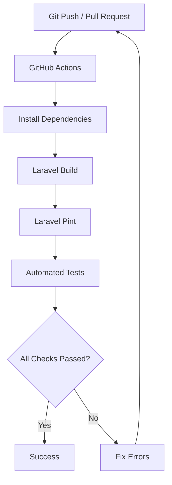
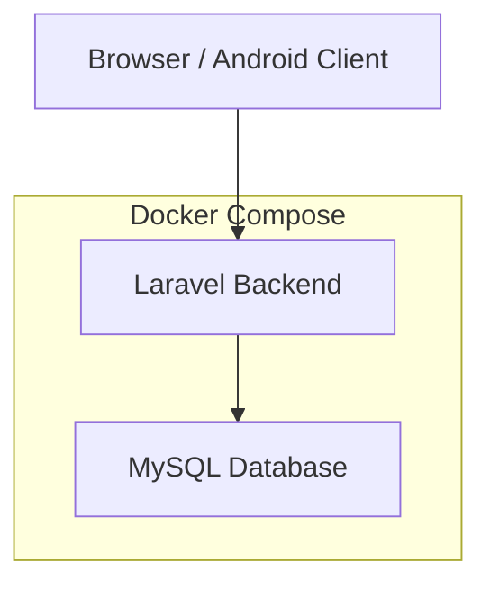

# FinPilot — Тестілеу жоспары (Test Plan)

## 1. Жалпы ақпарат

- Жоба атауы: FinPilot — Personal Finance Management System
- Команда: Team 2
- Жауапты маман: Қасымжанов Досжан
- Рөлі: QA & DevOps Engineer
- Құжат нұсқасы: 1.1
- Күні: 26.11.2026

## 2. Тестілеудің мақсаты

FinPilot жүйесінің функционалдық талаптарға сәйкестігін,
тұрақтылығын, қауіпсіздігін және дұрыс жұмыс істеуін тексеру.

Тестілеудің негізгі мақсаттары:

- Бағдарламалық қателерді анықтау.
- Бизнес-логиканың дұрыс орындалуын тексеру.
- REST API жұмысын тексеру.
- Дерекқордың дұрыс жұмыс істеуін тексеру.
- Пайдаланушы деректерінің қауіпсіздігін тексеру.
- Android және Laravel арасындағы байланысты тексеру.
- Автоматтандырылған тестілеу процесін ұйымдастыру.

## 3. Тестілеу құралдары

| Құрал | Қолданылуы |
|---|---|
| PHPUnit | Автоматтандырылған тесттер |
| Laravel Testing | Backend және API тестілеу |
| Postman | REST API сұраныстарын тексеру |
| Swagger | API құжаттамасы және тексеру |
| Laravel Pint | PHP код сапасын тексеру |
| GitHub Actions | Автоматтандырылған CI |
| Docker Compose | Тестілеу ортасын іске қосу |
| MySQL | Дерекқормен байланысты тексеру |
| Android Studio | Мобильді қосымшаны тестілеу |

## 4. Тестілеу түрлері

### 4.1. Unit Testing

Жүйенің жеке функциялары мен бизнес-логикасын
басқа компоненттерден тәуелсіз тексеру.

### 4.2. Integration Testing

Laravel, MySQL және Android компоненттерінің
өзара дұрыс байланысуын тексеру.

### 4.3. API Testing

REST API сұраныстарын, жауаптарын және HTTP
статус кодтарын тексеру.

### 4.4. UI Testing

Мобильді қосымшаның интерфейсін, батырмаларын,
енгізу өрістерін және навигациясын тексеру.

### 4.5. Security Testing

Авторизацияны, пайдаланушы рөлдерін, деректерге
қолжетімділікті және құпиясөз қауіпсіздігін тексеру.

## 5. Unit Test сценарийлері және нәтижелері

FinPilot жобасының қаржылық бизнес-логикасын тексеру
мақсатында 10 автоматтандырылған Unit Test жазылды.

| ID | Тестілеу сценарийі | Күтілетін нәтиже | Күйі |
|---|---|---|---|
| UT-01 | Кіріс сомасын есептеу | Жалпы кіріс дұрыс есептеледі | PASS |
| UT-02 | Шығыс сомасын есептеу | Жалпы шығыс дұрыс есептеледі | PASS |
| UT-03 | Балансты есептеу | Кіріс пен шығыс айырмасы анықталады | PASS |
| UT-04 | Теріс соманы тексеру | Теріс сома қабылданбайды | PASS |
| UT-05 | Нөлдік соманы тексеру | Нөлдік сома қабылданбайды | PASS |
| UT-06 | Айлық бюджетті тексеру | Бюджет сомасы нөлден үлкен болуы тиіс | PASS |
| UT-07 | Қалған бюджетті есептеу | Бюджет пен шығыс айырмасы есептеледі | PASS |
| UT-08 | Күндік статистиканы есептеу | Күндік нәтиже дұрыс есептеледі | PASS |
| UT-09 | Айлық статистиканы есептеу | Айлық нәтиже дұрыс есептеледі | PASS |
| UT-10 | Жылдық статистиканы есептеу | Жылдық нәтиже дұрыс есептеледі | PASS |

### 5.1. Бизнес-логика файлы

Файлдың орналасуы:

`backend/app/Services/FinanceCalculator.php`

FinanceCalculator класының негізгі әдістері:

- totalIncome()
- totalExpense()
- balance()
- validateAmount()
- validateBudget()
- remainingBudget()
- dailyStatistics()
- monthlyStatistics()
- yearlyStatistics()

Қаржылық есептеулердің дәлдігін сақтау мақсатында
ақша сомалары бүтін санмен, тиын түрінде беріледі.

### 5.2. Unit Test файлы

Файлдың орналасуы:

`backend/tests/Unit/FinanceCalculatorTest.php`

Бұл файлда PHPUnit арқылы қаржылық есептеулерді,
сомаларды валидациялауды және статистиканы
тексеретін 10 автоматтандырылған тест жүзеге асырылған.

Барлық 10 Unit Test жергілікті компьютерде және
GitHub Actions CI ортасында сәтті тексерілді.

### 5.3. Тестілеуді іске қосу

```bash
cd backend
php artisan test
```

Тек қаржылық Unit Test-терді іске қосу:

```bash
php artisan test --filter=FinanceCalculatorTest
```

Код сапасын тексеру:

```bash
vendor/bin/pint --test
```

Windows PowerShell ортасында:

```powershell
.\vendor\bin\pint.bat --test
```

## 6. Функционалдық және API тестілеу

| ID | Сценарий | Күтілетін нәтиже | Күйі |
|---|---|---|---|
| FT-01 | Жаңа пайдаланушыны тіркеу | Аккаунт жасалады | PLANNED |
| FT-02 | Дұрыс құпиясөзбен кіру | Жүйеге кіреді | PLANNED |
| FT-03 | Қате құпиясөзбен кіру | Қолжетімділік берілмейді | PLANNED |
| FT-04 | Қайталанатын email енгізу | Тіркелуге рұқсат берілмейді | PLANNED |
| FT-05 | Кіріс қосу | Дерекқорға сақталады | PLANNED |
| FT-06 | Шығыс қосу | Дерекқорға сақталады | PLANNED |
| FT-07 | Транзакциялар тізімін алу | Мәліметтер көрсетіледі | PLANNED |
| FT-08 | Транзакцияны өзгерту | Мәлімет жаңартылады | PLANNED |
| FT-09 | Транзакцияны жою | Мәлімет жойылады | PLANNED |
| FT-10 | Айлық бюджет орнату | Бюджет сақталады | PLANNED |
| FT-11 | Бір айға қайталама бюджет қосу | Қайталама бюджет қабылданбайды | PLANNED |
| FT-12 | Айлық бюджетті өзгерту | Бюджет жаңартылады | PLANNED |
| FT-13 | Авторизациясыз API сұранысы | Қолжетімділік берілмейді | PLANNED |
| FT-14 | Басқа пайдаланушының деректерін ашу | Қолжетімділік шектеледі | PLANNED |
| FT-15 | Пайдаланушы рөлдерін тексеру | Рөлге сәйкес рұқсаттар беріледі | PLANNED |

## 7. REST API статус кодтары

| HTTP коды | Мағынасы |
|---|---|
| 200 | Сұраныс сәтті орындалды |
| 201 | Жаңа мәлімет жасалды |
| 204 | Сұраныс орындалды, жауап денесі жоқ |
| 401 | Аутентификация қажет |
| 403 | Қолжетімділікке тыйым салынған |
| 404 | Мәлімет табылмады |
| 422 | Енгізілген мәлімет жарамсыз |
| 500 | Сервердің ішкі қатесі |

## 8. Қауіпсіздікті тестілеу

Жоспарланған қауіпсіздік тексерістері:

- Құпиясөздердің хэштеліп сақталуын тексеру.
- Авторизациясыз сұраныстарды шектеу.
- Пайдаланушы рөлдерін тексеру.
- Басқа пайдаланушының қаржылық деректеріне
  қолжетімділікті шектеу.
- Енгізілген мәліметтерді валидациялау.
- SQL Injection шабуылдарынан қорғанысты тексеру.
- Құпия конфигурациялардың GitHub-қа
  жүктелмеуін тексеру.

## 9. CI жұмыс процесі

GitHub Actions арқылы келесі тексерістер
автоматты түрде орындалады:

1. Репозиторийді жүктеу.
2. PHP ортасын дайындау.
3. Composer кітапханаларын орнату.
4. Laravel конфигурациясын кэштеу (Build).
5. Конфигурация кэшін тазалау.
6. Laravel Pint арқылы код сапасын тексеру.
7. PHPUnit тесттерін орындау.
8. CI нәтижесін шығару.

CI конфигурациясының орналасуы:

`.github/workflows/ci.yml`



## 10. Docker ортасын тексеру

FinPilot серверлік каркасы Docker Compose
арқылы сәтті іске қосылды.

### 10.1. Docker конфигурациялары

- `backend/Dockerfile`
- `backend/.dockerignore`
- `compose.yaml`

### 10.2. Жобаны іске қосу

```bash
docker compose up --build
```

Контейнерлердің күйін тексеру:

```bash
docker compose ps
```

Laravel серверінің адресі:

http://localhost:8000

### 10.3. Docker ортасының компоненттері

| Компонент | Нұсқасы |
|---|---|
| Docker Desktop | 4.100.1 |
| Docker Engine | 29.9.3 |
| Docker Compose | 5.7.1 |
| PHP | 8.5 |
| Laravel | 13.44.1 |
| MySQL | 8.4 |

### 10.4. Контейнерлердің күйі

| Контейнер | Қызметі | Нәтижесі |
|---|---|---|
| finpilot-backend | Laravel REST API ортасы | Running |
| finpilot-mysql | MySQL дерекқоры | Healthy |



Laravel серверлік каркасы, MySQL байланысы және
бастапқы миграциялар жергілікті Docker ортасында
сәтті тексерілді.

Android клиентімен интеграция әлі орындалмаған.

## 11. Тестілеудің ағымдағы нәтижелері

26.11.2026 күніндегі нәтижелер:

| Тексеріс | Нәтижесі |
|---|---|
| Laravel серверлік каркасы | PASS |
| Docker образын құрастыру | PASS |
| Docker Compose іске қосу | PASS |
| MySQL контейнері | PASS |
| Laravel және MySQL байланысы | PASS |
| Бастапқы миграциялар | PASS |
| Браузер арқылы тексеру | PASS |
| Laravel Build | PASS |
| Laravel Pint | PASS |
| Бастапқы Unit ExampleTest | PASS |
| Бастапқы Feature ExampleTest | PASS |
| FinPilot бизнес-логикасының 10 Unit Test-і | PASS |
| GitHub Actions CI | SUCCESS |
| REST API функционалдық тесттері | PLANNED |
| Қауіпсіздікті тестілеу | PLANNED |
| Android интерфейсін тестілеу | PLANNED |

### 11.1. Автоматтандырылған тестілеу нәтижелері

| Көрсеткіш | Нәтижесі |
|---|---|
| FinPilot Unit Tests | 10/10 PASS |
| Бастапқы Unit Test | 1/1 PASS |
| Барлық Unit Tests | 11/11 PASS |
| Feature Tests | 1/1 PASS |
| Жалпы тесттер саны | 12/12 PASS |
| Assertions | 13 |
| Failed Tests | 0 |
| Жергілікті орындалу уақыты | 0.66 секунд |
| Laravel Pint | PASS |

Терминал нәтижесі:

```text
PASS  Tests\Unit\ExampleTest

PASS  Tests\Unit\FinanceCalculatorTest
  total income
  total expense
  balance
  negative amount is rejected
  zero amount is rejected
  budget validation
  remaining budget
  daily statistics
  monthly statistics
  yearly statistics

PASS  Tests\Feature\ExampleTest

Tests:    12 passed (13 assertions)
Duration: 0.66s
```

### 11.2. GitHub Actions нәтижесі

- Workflow: FinPilot CI
- Branch: feature/devops-ci
- Commit: b68e4c9
- Commit message: Add finance calculator and 10 unit tests
- Status: Success
- Total duration: 18 seconds
- Build: PASS
- Linter: PASS
- Automated Tests: PASS

GitHub Actions:

https://github.com/doszhan2005/team-2-finpilot/actions

CI тексерісі кезінде actions/checkout@v4 нұсқасына
қатысты Node.js ескіру ескертуі анықталды.
Бұл ескерту CI жұмысына кедергі келтірмеді.

## 12. Design Review қабылдау критерийлері

| Талап | Ағымдағы күйі |
|---|---|
| Тіркелу және жүйеге кіру | PLANNED |
| Кемінде 2 пайдаланушы рөлі | PLANNED |
| Негізгі объектінің CRUD операциялары | PLANNED |
| Swagger API құжаттамасы | PLANNED |
| Кодта кемінде 1 жобалау паттерні | PLANNED |
| Кемінде 10 Unit Test | PASS |
| GitHub Actions CI жасыл болуы | PASS |
| Әр қатысушының кемінде 1 merged PR-ы | IN PROGRESS |
| v0.0-design тегін жасау | PLANNED |

## 13. QA & DevOps жұмыстары

QA & DevOps Engineer тарапынан орындалған жұмыстар:

- GitHub репозиторийін ұйымдастыру.
- GitHub Projects тақтасын дайындау.
- Laravel серверлік каркасын жасау.
- Dockerfile конфигурациясын дайындау.
- Docker Compose ортасын ұйымдастыру.
- Laravel және MySQL байланысын тексеру.
- GitHub Actions CI workflow жасау.
- Build және Linter тексерістерін ұйымдастыру.
- Тестілеу жоспарын дайындау.
- FinanceCalculator бизнес-логикасын жазу.
- 10 автоматтандырылған Unit Test жазу.
- Жергілікті және CI ортасында тестілеу.
- Анықталған конфигурациялық қателерді түзету.

## 14. Ағымдағы шектеулер

- FinanceCalculator класы REST API-мен әлі біріктірілмеген.
- REST API функционалдық тесттері әлі орындалмаған.
- Android қосымшасымен интеграцияны тексеру жоспарланған.
- Docker тексерістері жергілікті компьютерде орындалған.
- CI және Unit Test өзгерістері feature/devops-ci
  тармағында сақталған.
- Өзгерістерді Pull Request арқылы main тармағына
  біріктіру қажет.

## 15. Қорытынды

FinPilot жобасының тестілеу жоспары жүйенің сапасын,
тұрақтылығын және қауіпсіздігін қамтамасыз етуге
бағытталған.

Docker Compose ортасы, Laravel серверлік каркасы,
MySQL байланысы және GitHub Actions CI сәтті тексерілді.

Қаржылық бизнес-логиканы тексеретін 10 Unit Test
жазылып, барлық тесттер сәтті орындалды.

Жалпы автоматтандырылған тестілеу нәтижесі:
12 passed, 13 assertions, 0 failed.

Келесі кезеңде REST API, дерекқор және Android
мобильді қосымшасының функционалдарын біріктіру
және кешенді тестілеу жоспарланған.
